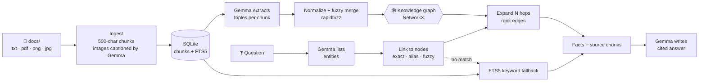

<div align="center">

# 🕸️ Bright Studio GraphRAG


### Ask your agency's documents anything. Answers come from a **knowledge graph**, not a vector database.

100% local · No embeddings · No vector DB · No cloud API · Every answer cites its sources


</div>

---

## ✨ What is this?

A question-answering assistant for a fictional design agency, **Bright Studio**. It reads the agency's files (`.txt`, `.pdf`, `.png`, `.jpg`), turns them into a **graph of entities and relationships**, and answers questions by walking that graph. A local **Gemma** model writes the final answer.

```text
Q: Who should I talk to about billing?
A: Contact Aisha Rahman for billing questions [team.txt#5, team.txt#4].
```

## 🚀 Highlights

| | |
|---|---|
| 🕸️ **Graph retrieval** | Gemma extracts `(subject, relation, object)` triples. Questions are answered by multi-hop traversal, which suits "who handles the cheapest package?" style questions. |
| 🖼️ **Multimodal ingest** | PDFs, text files, and images, including images embedded in PDFs. Gemma captions images and stores them as chunks. |
| 🔒 **Fully local** | Runs on Ollama. Your documents never leave your machine. |
| 📎 **Cited answers** | Each answer points to the chunks it used (`team.txt#5`). |
| 🔍 **Transparent** | `ask` prints the full retrieval trace: linked entities, hops, facts, and chunks. |
| 🛟 **Safe fallback** | If no entity in the question links to the graph, it falls back to SQLite FTS5 keyword search and says so. |
| ⚡ **Cached builds** | Triples are cached by chunk hash and captions by image hash, so rebuilds only redo what changed. |
| 💬 **Chat UI** | A paper-and-glass Gradio interface for non-technical users. |

## 🧠 How it works



1. **Ingest.** Files become chunks (500 characters, 100 overlap) tagged with source, page, and type.
2. **Build the graph.** Gemma extracts triples per chunk. Names are normalized and near-duplicates merged. Every edge keeps its `chunk_id`, so facts can always be traced to their source text.
3. **Ask.** Gemma lists the entities in the question. They are linked to graph nodes, expanded `HOPS` hops, and the edges are ranked. The top facts and their source chunks go into the prompt.

## 🏁 Quick start

**Prerequisites:** Python 3.10+ and [Ollama](https://ollama.com) with a Gemma model pulled.

```bash
# 1. Install
python -m venv venv && venv\Scripts\activate      # macOS/Linux: source venv/bin/activate
pip install -r requirements.txt

# 2. Check the model tag matches LLM_MODEL in config.py (default: gemma4:12b)
ollama list

# 3. Build the knowledge base
python cli.py ingest          # docs/ -> chunks in data/chunks.db
python cli.py build-graph     # chunks -> triples -> data/graph.json

# 4. Ask
python cli.py ask "How do I cancel my contract?"
```

## 🎮 Commands

| Command | What it does |
|---|---|
| `python cli.py ingest` | Load `docs/` into chunks (images captioned by Gemma, cached) |
| `python cli.py build-graph` | Extract triples and build the graph (cached by chunk hash) |
| `python cli.py ask "question"` | One answer plus the full retrieval trace |
| `python cli.py chat` | Interactive terminal chat |
| `python cli.py inspect` | Graph stats, top entities, entity merges, sample edges |
| `python evaluate.py` | Run the questions in `test_questions.json` |
| `python app.py` | Launch the web UI at http://127.0.0.1:7860 |

`ingest` and `build-graph` accept `--limit N` to process only the first N items while testing.

## 📊 Evaluation

`evaluate.py` runs 13 questions covering direct lookups, paraphrases, multi-hop questions, and trap questions the documents can't answer.

| Setup | Score | Cited |
|---|---|---|
| GraphRAG baseline (`HOPS=2`, chunk 500/100, `FUZZY_MERGE=90`, prompt `v1`) | **10 / 13** | 12 / 13 |

- ✅ Direct questions, paraphrases, and traps all pass. Traps get an honest *"I do not know"* instead of a made-up answer.
- ❌ The three misses are multi-hop questions. Retrieval found the right seed entity but ranked case-study and PDF chunks above the team and pricing chunks.
- 🔬 Next experiments: `HOPS=3`, a higher `MAX_CHUNKS`, ranking chunks by the number of facts they touch, and merging FTS5 results with graph chunks.

The full experiment log, including the earlier vector-search runs, is in [`notes.md`](notes.md).

## ⚙️ Configuration

Everything lives in [`config.py`](config.py):

| Setting | Default | Meaning |
|---|---|---|
| `LLM_MODEL` | `gemma4:12b` | Exact tag from `ollama list` |
| `NUM_CTX` | `8192` | Context window |
| `CHUNK_SIZE` / `CHUNK_OVERLAP` | `500` / `100` | Chunking |
| `FUZZY_MERGE` | `90` | rapidfuzz score for merging entities at build time |
| `FUZZY_LINK` | `85` | rapidfuzz score for linking question entities |
| `HOPS` | `2` | Graph expansion depth |
| `MAX_FACTS` / `MAX_CHUNKS` | `20` / `6` | What goes into the prompt |
| `MAX_EDGES_PER_NODE` | `25` | Caps expansion through very common nodes |
| `PROMPT_VERSION` | `v1` | Bump it to invalidate the triple cache |

To change the extraction prompt, edit it in `rag/graph_build.py` and bump `PROMPT_VERSION`.

## 🗂️ Project structure

```text
agency-rag/
├── cli.py              # ingest · build-graph · ask · chat · inspect
├── app.py              # Gradio web UI
├── evaluate.py         # scores test_questions.json
├── config.py           # all settings
├── rag/
│   ├── loaders.py      # txt / pdf / image -> chunks
│   ├── store.py        # SQLite chunks + FTS5
│   ├── graph_build.py  # triple extraction, merging, graph save/load
│   ├── graph_query.py  # entity linking and multi-hop expansion
│   ├── answer.py       # prompt assembly and answering
│   └── llm.py          # Ollama client and health checks
├── docs/               # source documents
├── data/               # generated: chunks.db, graph.json, caches
├── tools/              # make_report.py (builds the sample PDF)
└── legacy_vector/      # earlier Chroma + sentence-transformers version
```

## 🩺 Troubleshooting

- **"Ollama isn't running" or "model missing".** Start Ollama and make sure `LLM_MODEL` matches a tag in `ollama list`. Commands stop with a clear message.
- **CUDA out-of-memory on a small GPU.** Lower `NUM_CTX` in `config.py`. The experiment log records this on a 4 GB card.
- **Answers feel stale after editing docs.** Re-run `ingest` and `build-graph`. Unchanged chunks are served from cache.

## 📝 Notes

- `legacy_vector/` keeps the first Chroma + embeddings version for comparison. The new code doesn't use it.
- Answers take roughly 8 to 15 seconds on a 4 GB GPU running a 12B model split across GPU and CPU.

---

<div align="center">

Built with Ollama · NetworkX · SQLite FTS5 · rapidfuzz · PyMuPDF · Gradio

</div>
